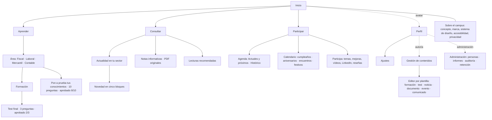
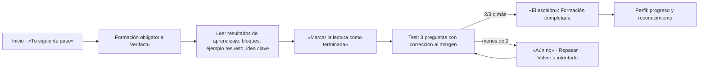
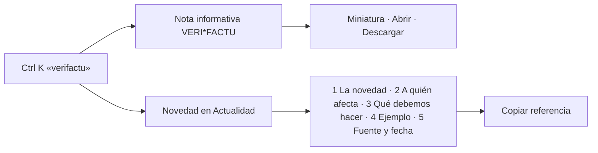
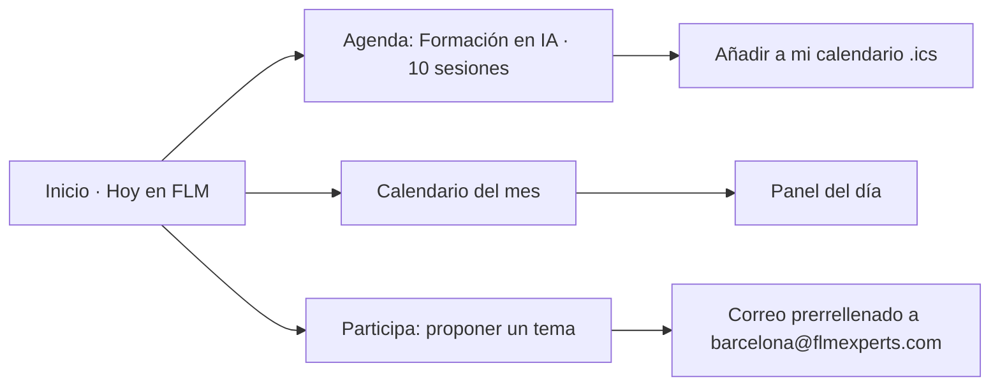
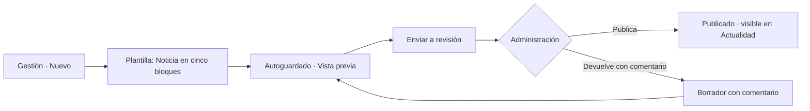
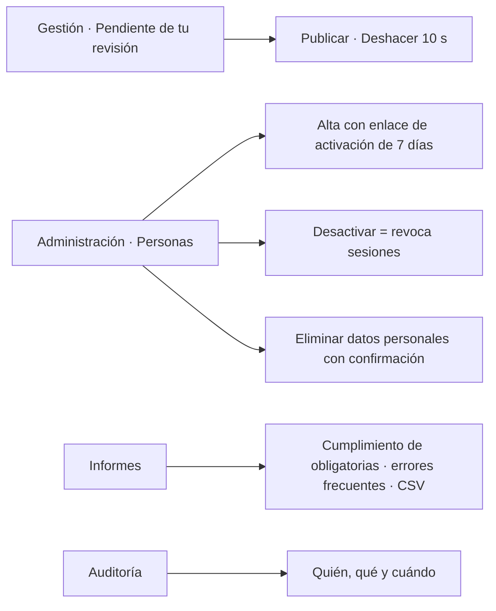

# 04 · Arquitectura de información y recorridos

## 1. Principio de organización

La navegación principal sigue los tres propósitos del campus más un punto de partida personal. Cada destino tiene un propósito único; no hay secciones redundantes.

| Destino | Propósito | Intenciones que resuelve |
|---|---|---|
| **Inicio** | Punto de partida personal con datos vivos | «Quiero saber qué tengo pendiente» · «¿Qué pasa hoy en FLM?» |
| **Aprender** | Formación por área, tests y evaluaciones | «Quiero aprender algo útil» |
| **Consultar** | Biblioteca: Actualidad, Notas informativas, Lecturas | «Necesito un documento» · «Quiero entender una novedad» |
| **Participar** | Agenda, calendario y aportaciones | «¿Qué está pasando en la firma?» · «Quiero aportar algo» |
| Perfil (avatar) | Progreso, resultados, reconocimientos, ajustes | «¿Cómo voy?» |
| Gestión (autoría y administración) | Crear, revisar y publicar contenidos | «Quiero aportar contenido» · «Necesito gestionar contenido» |
| Administración | Personas, accesos, informes, auditoría | «Necesito gestionar accesos» |

La búsqueda global (Ctrl/⌘ K o «/») atraviesa todo: formaciones, novedades, notas, lecturas, agenda, personas y secciones.

## 2. Mapa del sitio

## 3. Recorridos clave

### Empleado: aprender algo útil y demostrarlo

### Empleado: encontrar un documento y entender una novedad

### Empleado: saber qué pasa y participar

### Autor: aportar contenido

### Administración: gestionar contenido y accesos

## 4. Coherencia escritorio–móvil

- Mismos destinos y en el mismo orden: cabecera en escritorio, barra inferior en móvil (Inicio, Aprender, Consultar, Participar, Perfil).
- Búsqueda en la cabecera en ambos tamaños.
- Paneles laterales en escritorio que pasan a hojas inferiores en móvil.
- Calendario: cuadrícula en escritorio; tira semanal y lista en móvil.
- Lectura: índice y glosario al margen en escritorio; desplegables en línea en móvil.

## 5. Rutas directas

La demostración usa rutas con *hash* para que cualquier enlace directo funcione en GitHub Pages (p. ej. `…/#/aprender/fiscal`, `…/#/consultar/notas/doc-boicac-147`, `…/#/participar/agenda/desayuno-mercantil-radar`). La versión privada puede usar rutas limpias servidas por la API.
