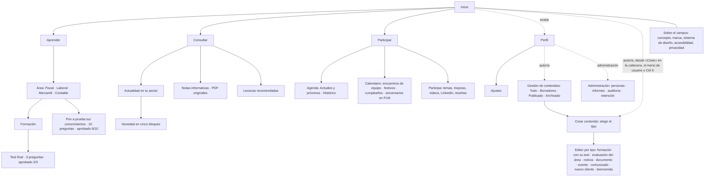
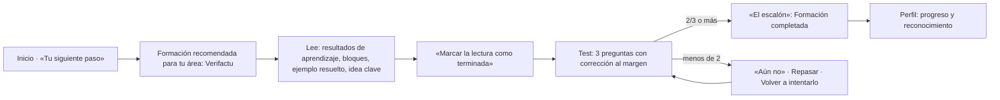
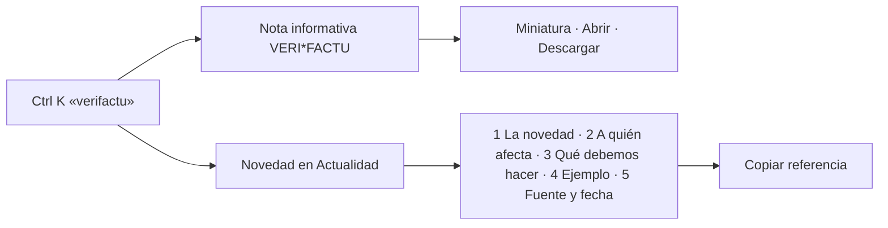
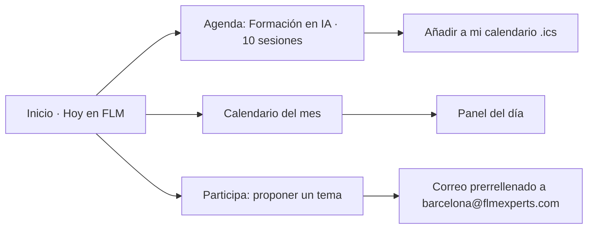
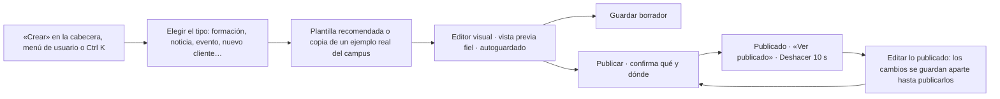
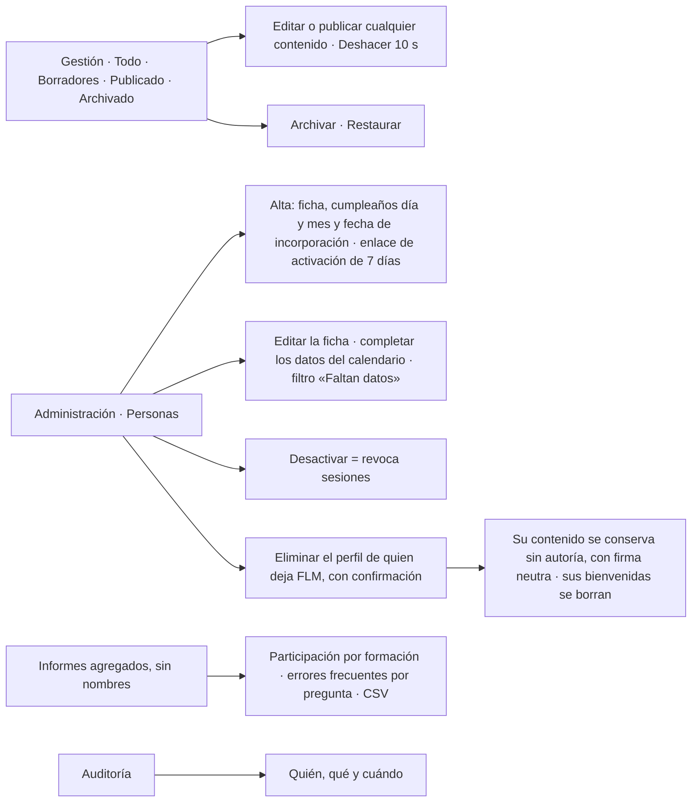

# 04 · Arquitectura de información y recorridos

## 1. Principio de organización

La navegación principal sigue los tres propósitos del campus más un punto de partida personal. Cada destino tiene un propósito único; no hay secciones redundantes.

| Destino | Propósito | Intenciones que resuelve |
|---|---|---|
| **Inicio** | Punto de partida personal con datos vivos | «¿Por dónde sigo?» · «¿Qué pasa hoy en FLM?» |
| **Aprender** | Formación por área, tests y evaluaciones | «Quiero aprender algo útil» |
| **Consultar** | Biblioteca: Actualidad, Notas informativas, Lecturas | «Necesito un documento» · «Quiero entender una novedad» |
| **Participar** | Agenda, calendario y aportaciones | «¿Qué está pasando en la firma?» · «Quiero aportar algo» |
| Perfil (avatar) | Progreso, resultados, reconocimientos, ajustes | «¿Cómo voy?» |
| Gestión (autoría y administración) | Crear contenidos, guardarlos como borrador y publicarlos | «Quiero aportar contenido» · «Necesito gestionar contenido» |
| Administración | Personas (alta y ficha, con los datos del calendario), accesos, eliminación del perfil de quien deja FLM, informes agregados (sin nombres), auditoría | «Necesito gestionar accesos» · «¿Cómo va cada formación?» |

La búsqueda global (Ctrl/⌘ K o «/») atraviesa todo: formaciones, novedades, notas, lecturas, agenda y secciones.

Todas las formaciones son voluntarias, sin fechas límite. «Tu siguiente paso», en Inicio, propone la formación que dejaste a medias (la última que tocaste); si no hay ninguna, la siguiente sin completar recomendada para tu área y, si no, la siguiente sin completar del campus.

## 2. Mapa del sitio

## 3. Recorridos clave

### Empleado: aprender algo útil y demostrarlo

### Empleado: encontrar un documento y entender una novedad

### Empleado: saber qué pasa y participar

### Autor: aportar contenido

No hay revisión previa ni cola de revisión: los estados son **Borrador**, **Publicado** y **Archivado**. La autoría publica lo suyo; administración edita, publica, archiva y restaura cualquier contenido. Al publicar, quien publica puede marcar «Lo ha revisado el área» y el contenido muestra «Revisado por …»; si no lo marca, queda pendiente de revisión, también al publicar los cambios de algo que ya estaba revisado.

Los cambios guardados de algo publicado son de quien firma ese contenido, no de quien los empezó: solo esa persona (o administración) los publica o los descarta, y en Gestión llevan su autoría. El tipo también cuenta en cada acción, no solo al crear: la evaluación del área es de administración aunque figure como propia de alguien que ahora es autor.

### Crear contenido: tipos y destinos

El creador (`/gestion/nuevo`) agrupa los tipos por el lugar del campus donde se verán. Cada tarjeta dice qué es y dónde aparece.

| Grupo | Tipo | Qué se construye | Dónde aparece |
|---|---|---|---|
| Aprender | Formación | Portada tipográfica, apartados y subapartados, párrafos, listas, recuadros (Explicamos, Atención, Consejo, Norma) con referencias, ejemplo resuelto por pasos, tablas (también pegadas desde Excel), citas, figuras con fotos aprobadas, los 13 apoyos interactivos, términos clave, resultados de aprendizaje, idea clave, fuentes y documentos vinculados | Aprender › su área |
| Aprender | Test final | Tres preguntas dentro de su formación, con explicación, «por qué no» de cada opción y «Repasa» enlazado a su apartado; se supera con 2 | Al final de la formación |
| Aprender | Evaluación del área (administración) | Una por área: se empieza eligiendo el área y, si ya tiene la suya, se abre esa. Diez preguntas sobre las formaciones del área, que se pueden importar de sus tests; se supera con 8. Archivada, deja de verse en Aprender y el área puede tener otra; solo se restaura si el área no tiene otra, publicada o en borrador (la misma regla que la API) | Aprender › su área › Evaluación |
| Consultar | Noticia | Cinco bloques: qué cambia, a quién afecta, qué hacer, un ejemplo y la fuente con fecha | Consultar › Actualidad |
| Consultar | Documento | PDF original con su ficha, versión e historial de sustituciones | Consultar › Notas informativas |
| Participar | Evento | Una o varias sesiones (o «fecha por confirmar»), materiales, enlaces y foto aprobada | Participar › Agenda |
| Participar | Comunicado | Aviso para toda la firma con fechas clave | Participar › Agenda |
| Inicio · Ponte al día | Nuevo cliente | Nombre, sector, país de origen (lista común), área y una frase; confirmación de que se puede anunciar | Inicio › Ponte al día |
| Inicio · Ponte al día | Bienvenida | Persona activa del directorio sin bienvenida previa y un mensaje breve, sin fecha de incorporación; confirmación de que la persona lo sabe | Inicio › Ponte al día |

Los errores de validación se listan en un resumen con enlace a cada campo y el editor abre el paso o el bloque donde está el error.

### Administración: gestionar contenido y accesos

Un contenido sin autoría (o cuya persona ya no está en el campus) se firma con la firma neutra: «Área Fiscal de FLM», con su área, en formaciones y evaluaciones, y «FLM» en el resto. En Gestión aparece como «Sin autoría» y solo administración lo edita; las evaluaciones del área, que nunca tienen autoría personal, también. El resumen de Administración enlaza al filtro «Autoría › Sin autoría» de Gestión con el mismo recuento que se ve al abrirlo, aparte del enlace a los borradores.

### Calendario de empresa: cumpleaños y aniversarios desde la ficha

El calendario (Participar › Calendario) muestra, además de los encuentros de equipo y los festivos, el cumpleaños de cada persona activa cada año y su aniversario de incorporación desde que se cumple el primer año (incorporación el 1 de septiembre de 2026 → primer aniversario el 1 de septiembre de 2027). Cada tipo lleva su icono, su color y su nombre en los filtros, en la cuadrícula, en el panel del día y en la lista móvil.

- **No se guardan como eventos**: se calculan a partir de la ficha (`personalEntries`, en `@flm/shared`), con un id estable por persona, tipo y año. Editar la ficha mueve la fecha al momento y nunca la duplica; desactivar la cuenta la retira del calendario y eliminar el perfil borra los datos.
- **Cumpleaños, solo día y mes**: nunca el año de nacimiento. El 29 de febrero se celebra el 28 en los años no bisiestos.
- **Alta** (Administración › Personas › «Dar de alta a una persona»): el cumpleaños (dos selectores, día y mes, que no admiten fechas imposibles) y la fecha completa de incorporación (como mucho, un año vista: el mismo tope en la web y en la API, `startDateLimitIssue`) son obligatorios, con la explicación de para qué se usan. Se valida con los esquemas compartidos (`personSchema`, `birthdaySchema`, `fullDateSchema`), con un resumen de errores que lleva a cada campo.
- **Perfiles anteriores sin estos datos**: se muestran «Sin indicar» y nunca se inventan. Nada se bloquea: la persona los completa desde su perfil o desde Ajustes › Calendario (corrige su cumpleaños cuando quiera; la fecha de incorporación que ya consta solo la cambia administración), y administración, con «Editar la ficha». Personas avisa de cuántos perfiles los tienen incompletos y los filtra («Calendario › Faltan datos»).
- **Auditoría**: `persona.alta`, `persona.editar` (administración) y `perfil.fechas` (la propia persona; el mismo código que la API), con los nombres de los campos y nunca los valores.
- **Demo**: las altas se guardan en este navegador (`extraPeople`) y los cambios de ficha en `peopleOverrides`; «Restablecer» los borra. En la versión interna, `POST /api/people`, `PATCH /api/people/:id` y `PATCH /api/me/personal-dates`.

## 4. Coherencia escritorio–móvil

- Mismos destinos y en el mismo orden: cabecera en escritorio, barra inferior en móvil (Inicio, Aprender, Consultar, Participar, Perfil).
- Búsqueda en la cabecera en ambos tamaños.
- Paneles laterales en escritorio que pasan a hojas inferiores en móvil.
- Calendario: cuadrícula en escritorio; tira semanal y lista en móvil, con los cuatro tipos de fecha en ambos.
- Lectura: índice y glosario al margen en escritorio; desplegables en línea en móvil.

## 5. Rutas directas

La demostración usa rutas con *hash* para que cualquier enlace directo funcione en GitHub Pages (p. ej. `…/#/aprender/fiscal`, `…/#/consultar/notas/doc-boicac-147`, `…/#/participar/agenda/desayuno-mercantil-radar`). La versión privada puede usar rutas limpias servidas por la API.

Eventos y comunicados comparten la ruta `/participar/agenda/<dirección>`: son un solo espacio de direcciones y, al publicar, cada uno recibe una distinta (si «flm-awards» ya es de un comunicado, el evento nuevo será «flm-awards-2»).
