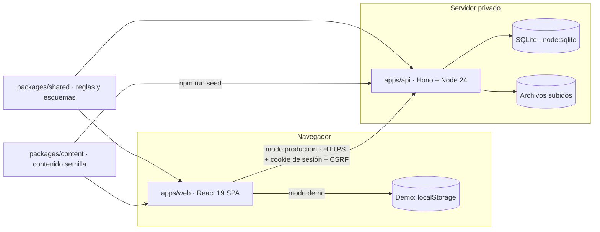

# 06 · Arquitectura técnica

## Visión general

- **Una sola fuente de reglas** (`packages/shared`): fechas en Europe/Madrid, fase de los eventos (próximo, en curso, histórico, archivado; varias sesiones; fecha pendiente; reclasificación manual), estados de aprendizaje (leída, test intentado, test superado, completada), corrección de tests, permisos por rol y transiciones editoriales. La demo y el servidor aplican exactamente la misma lógica; en producción la autoridad es el servidor.
- **Contenido como datos tipados** (`packages/content`): validado con zod en cada compilación (`npm run lint:content`).
- **Dos modos de compilación del cliente** (`vite --mode demo|production`): la demo publica datos de ejemplo y simula las escrituras en el navegador; la versión privada consume la API.

## Cliente (apps/web)

- React 19, React Router 8 (rutas con *hash* para GitHub Pages; cada sección se carga bajo demanda), Motion 14 para animación, zustand para el estado de la demo, pdf.js para miniaturas reales de los PDF.
- Diseño: tokens CSS (`styles/tokens.css`), CSS Modules por componente, tipografías autoalojadas (sin peticiones a terceros), imágenes AVIF/WebP responsive con marcador difuminado.
- Accesibilidad: componentes con patrones ARIA (diálogo nativo, pestañas, combobox de búsqueda), foco gestionado al navegar, `aria-live` para resultados, movimiento reducido global.
- Rendimiento: división por rutas, carga perezosa de pdf.js y de secciones, imágenes con dimensiones explícitas (sin saltos de diseño), fuentes con `unicode-range`.

## API (apps/api)

Ver [`apps/api/README.md`](../apps/api/README.md): Hono sobre Node 24 con SQLite (`node:sqlite`), migraciones SQL versionadas, contraseñas con scrypt, sesiones con token aleatorio guardado como hash y cookie `__Host-` HttpOnly/SameSite, CSRF por sesión y comprobación de origen, límites de frecuencia, validación zod de todas las entradas, autorización en servidor con la matriz de `shared`, subidas validadas por cabecera mágica y tamaño, auditoría, retención y copias de seguridad.

## Seguridad (resumen)

| Requisito | Implementación |
|---|---|
| Autorización en servidor | Middleware por permiso + comprobación de propiedad y de transición editorial |
| Validación de entradas | Esquemas zod compartidos |
| Contraseñas | scrypt con sal aleatoria; nunca se guardan ni registran en claro |
| Sesiones y revocación | Token aleatorio (hash en BD), caducidad por inactividad y absoluta, revocación individual y masiva |
| CSRF y XSS | Token CSRF por sesión + `Origin`; CSP estricta; React escapa por defecto; el texto enriquecido se interpreta sin HTML |
| Subidas seguras | Lista blanca por cabecera mágica, límite de tamaño, nombres aleatorios fuera de rutas públicas, descarga con `Content-Disposition` y `nosniff` |
| Límites de frecuencia | Inicio de sesión, recuperación, subidas y general |
| Secretos | Solo variables de entorno (`.env.example` sin valores reales) |
| Minimización de datos | Solo datos profesionales mínimos: el campus no guarda cumpleaños ni fechas de incorporación. Los informes de formación son agregados y sin nombres |
| Auditoría | Registro de acciones de seguridad y editoriales |
| Copias y recuperación | `VACUUM INTO` programado y procedimiento de restauración |

## Demo pública frente a versión privada

La demo pública no contiene credenciales ni registros privados: las personas reales aparecen solo con información profesional pública (y la persona de la demostración, con su nombre y su autorización, pero sin fotografía). Las acciones de administración están rotuladas como simulación. La versión privada se despliega por separado, con autenticación real.
