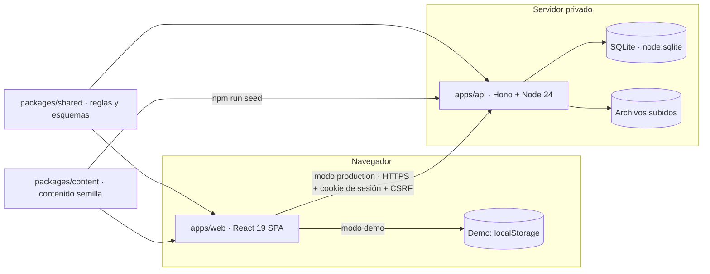

# 06 · Arquitectura técnica

## Visión general

- **Una sola fuente de reglas** (`packages/shared`): fechas en Europe/Madrid, fase de los eventos (próximo, en curso, histórico, archivado; varias sesiones; fecha pendiente; reclasificación manual), estados de aprendizaje (leída, test intentado, test superado, completada), corrección de tests, permisos por rol, tipos con los que trabaja cada rol (`canHandleType()`, en cada acción, no solo al crear), una evaluación vigente por área (`assessmentClashReason()`, el mismo motivo en la demo y en la API), transiciones editoriales (`checkTransition()`: guardar borrador, publicar, archivar y restaurar, sin revisión previa, con un código estable por motivo de rechazo) y firma neutra de los contenidos sin autoría (`neutralSignature()`). La demo y el servidor aplican exactamente la misma lógica; en producción la autoridad es el servidor.
- **Contenido como datos tipados** (`packages/content`): validado con zod en cada compilación (`npm run lint:content`).
- **Dos modos de compilación del cliente** (`vite --mode demo|production`): la demo publica datos de ejemplo y simula las escrituras en el navegador; la versión privada consume la API.

## Cliente (apps/web)

- React 19, React Router 8 (rutas con *hash* para GitHub Pages; cada sección se carga bajo demanda), Motion 14 para animación, zustand para el estado de la demo, pdf.js para miniaturas reales de los PDF.
- Diseño: tokens CSS (`styles/tokens.css`), CSS Modules por componente, tipografías autoalojadas (sin peticiones a terceros), imágenes AVIF/WebP responsive con marcador difuminado.
- Accesibilidad: componentes con patrones ARIA (diálogo nativo, pestañas, combobox de búsqueda), foco gestionado al navegar, `aria-live` para resultados, movimiento reducido global.
- Rendimiento: división por rutas, carga perezosa de pdf.js y de secciones, imágenes con dimensiones explícitas (sin saltos de diseño), fuentes con `unicode-range`.
- Creador de contenidos (`features/manage`): `/gestion` (Todo · Borradores · Publicado · Archivado), `/gestion/nuevo` (el tipo, agrupado por destino) y `/gestion/nuevo/:tipo` o `/gestion/editar/:id` (el editor). Cada tipo tiene un modelo de formulario (`forms.ts`) que se convierte 1:1 en el tipo compartido y se valida con su esquema zod: cada error lleva la ruta del campo, el resumen enlaza al campo y el editor abre su paso o su bloque. Plantillas (`templates.ts`) y copia de ejemplos reales; vista previa fiel con las mismas piezas de lectura; autoguardado; acciones con «Deshacer» (`actions.ts`).
- Estado de la demo (zustand con `persist`, versión 3 y migraciones paso a paso `toV2` → `toV3`): los borradores de Gestión viven en `drafts` (`rev-<id>` guarda los cambios de un contenido publicado sin tocar la versión pública, como `content_revisions` en la API); lo publicado desde Gestión, en listas propias (`extraFormations`, `extraAssessments`, `extraNews`, `extraDocuments`, `extraEvents`, `extraClients`, `extraWelcomes`) y en `contentOverrides` y `statusOverrides`, que los selectores (`mergeContent`) combinan con el contenido semilla. La versión 3 pasa a borrador lo que estaba «en revisión» y lleva los tests antiguos a su formación; además, devuelve a borrador las formaciones que el editor anterior dio por publicadas sin llevarlas a Aprender, retira los restos de «Deshacer» y convierte las fichas anonimizadas en perfiles eliminados.

## API (apps/api)

Ver [`apps/api/README.md`](../apps/api/README.md): Hono sobre Node 24 con SQLite (`node:sqlite`), migraciones SQL versionadas, contraseñas con scrypt, sesiones con token aleatorio guardado como hash y cookie `__Host-` HttpOnly/SameSite, CSRF por sesión y comprobación de origen, límites de frecuencia, validación zod de todas las entradas, autorización en servidor con la matriz de `shared`, subidas validadas por cabecera mágica y tamaño, auditoría, retención y copias de seguridad.

En el flujo editorial, la API comprueba en cada acción (guardar, publicar, descartar, borrar, consultar) que el rol trabaja con el tipo (`canHandleType()`), además de la propiedad y la transición. «Guardar borrador» valida una versión laxa del esquema del tipo, construida en la API a partir del compartido (misma forma, tipos, formatos y longitudes máximas; sin obligatorios ni mínimos), y publicar exige el esquema completo. Las reglas entre contenidos también son del servidor: una evaluación vigente por área, un solo espacio de slugs para eventos y comunicados (comparten la dirección de la agenda) y una bienvenida por persona. Como en la demo, los cambios de algo publicado esperan en una revisión (`content_revisions`) hasta publicarla, también el PDF nuevo de un documento, y publicarlos sin «Lo ha revisado el área» deja la revisión pendiente.

## Seguridad (resumen)

| Requisito | Implementación |
|---|---|
| Autorización en servidor | Middleware por permiso + comprobación del tipo de contenido (`canHandleType()`), de propiedad y de transición editorial (403 `SIN_PERMISO` o `SOLO_LO_PROPIO`, 409 `TRANSICION_NO_VALIDA`) |
| Validación de entradas | Esquemas zod compartidos (los borradores, con su versión laxa; al publicar, el esquema completo) |
| Contraseñas | scrypt con sal aleatoria; nunca se guardan ni registran en claro |
| Sesiones y revocación | Token aleatorio (hash en BD), caducidad por inactividad y absoluta, revocación individual y masiva |
| CSRF y XSS | Token CSRF por sesión + `Origin`; CSP estricta; React escapa por defecto; el texto enriquecido se interpreta sin HTML |
| Subidas seguras | Lista blanca por cabecera mágica, límite de tamaño, nombres aleatorios fuera de rutas públicas, descarga con `Content-Disposition` y `nosniff` |
| Límites de frecuencia | Inicio de sesión, recuperación, subidas y general |
| Secretos | Solo variables de entorno (`.env.example` sin valores reales) |
| Minimización de datos | Solo datos profesionales mínimos: el campus no guarda cumpleaños ni fechas de incorporación (tampoco las bienvenidas). Los informes de formación son agregados y sin nombres. Eliminar el perfil de quien deja FLM borra sus datos y conserva su contenido sin autoría |
| Auditoría | Registro de acciones de seguridad y editoriales |
| Copias y recuperación | `VACUUM INTO` programado y procedimiento de restauración |

## Demo pública frente a versión privada

La demo pública no contiene credenciales ni registros privados: las personas reales aparecen solo con información profesional pública (y la persona de la demostración, con su nombre y su autorización, pero sin fotografía). Las acciones de administración están rotuladas como simulación: publicar, archivar o eliminar un perfil solo cambia lo que se ve en ese navegador. En la demo, las bienvenidas solo se pueden dar a personas ficticias (anunciar la llegada de una persona real sería inventar un hecho sobre ella) y las fotos de eventos y figuras se eligen entre las aprobadas. La versión privada se despliega por separado, con autenticación real.
